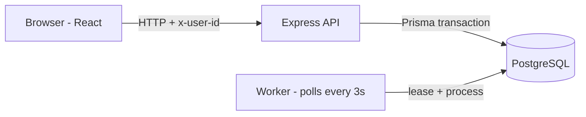

# Newtonite Ops Tracker

An internal operations work tracker (incidents, customer issues, payment investigations, compliance requests, internal tasks) for multiple teams. The focus is correctness: concurrency safety, server-side authorization, an audit trail, and a workflow that cannot be bypassed from the client.

- **Backend:** Node.js, TypeScript, Express 4, Prisma 6, PostgreSQL
- **Frontend:** React 19 + TypeScript (Vite)
- **Tests:** Vitest + Supertest integration tests against a real Postgres

## Setup

### Option A: one command (Docker)

```bash
docker compose up --build
```

Starts PostgreSQL, the API (applies migrations and seeds on first start) and the UI at http://localhost:5173 (API on http://localhost:4000/api). Reset everything with `docker compose down -v`.

### Option B: run locally

Prerequisites: Node 20+ and a PostgreSQL database (Docker or a hosted one such as Neon).

```bash
# 1. Database (local option)
docker compose up -d

# 2. Backend
cd backend
cp .env.example .env          # edit DATABASE_URL if you are not using docker-compose
npm install
npx prisma migrate deploy     # create tables
npm run seed                  # 3 teams, 6 users, 1,003 work items
npm run dev                   # API on http://localhost:4000

# 3. Frontend (new terminal)
cd frontend
npm install
npm run dev                   # UI on http://localhost:5173
```

The frontend talks to `http://localhost:4000/api` by default; override with `VITE_API_URL`.

### Tests

```bash
cd backend
npm test
```

The tests use the database from `DATABASE_URL` and the seeded users, and create their own work items (they do not delete them). Re-run `npm run seed` for a clean slate. Against a remote database the run can take about a minute, so the timeout is raised in `vitest.config.mts`.

## Demo users

All passwords are `password123`. The UI has an "Acting as" switcher, so no login screen is needed.

| User | Email | Roles |
|---|---|---|
| Alice Sharma | alice.lead@newtonite.com | Engineering LEAD, Payments VIEWER |
| Bob Verma | bob.member@newtonite.com | Engineering MEMBER |
| Charlie Nair | charlie.member@newtonite.com | Engineering MEMBER |
| Diana Patel | diana.lead@newtonite.com | Payments LEAD |
| Evan Gupta | evan.member@newtonite.com | Compliance MEMBER |
| Admin | admin@newtonite.com | ADMIN on all teams |

## What to try (2-minute evaluator tour)

1. **Simultaneous claim.** Open an unassigned item, press *Simulate simultaneous claim*. Two requests from two users fire at once; one gets `200`, the other `409`.
2. **Stale edit.** Press *Simulate stale edit*. A write using an old `version` is rejected with `409` and a banner shows the server's current state with a *Reload latest* button. For a real two-user test, open two tabs as different users, load the same item, save in both.
3. **Idempotent create.** *New item* then *Test: submit twice at once*. Both requests carry the same `Idempotency-Key`; only one item is created and the second response is flagged `X-Idempotent-Replay: true`.
4. **Workflow and approval.** As Bob, take a HIGH/CRITICAL item to `IN_PROGRESS`, try `RESOLVED` (rejected, 403), move it to `AWAITING_APPROVAL` with a note, then switch to Alice and *Approve & resolve*. Missing notes (400) and invalid jumps such as `OPEN -> CLOSED` (400) are rejected.
5. **Team isolation.** As Evan (Compliance), open an Engineering item URL via the API or try the team filter: `403`.
6. **Audit and async jobs.** Every change appears in the item's *Activity history* with before/after values. The *Jobs* drawer shows the queue the worker drains every 3 seconds.

## Architecture

```
React SPA  --x-user-id header-->  Express API  -->  Prisma  -->  PostgreSQL
                                      |
                                background worker (setInterval, polls Job table every 3s)
```

- `backend/src/app.ts` routes and business rules; `auth.ts` identity and role helpers; `worker.ts` job processor.
- **Authorization** is resource-level and server-side. Each item belongs to a team; every read/write resolves the caller's role *in that item's team*. Roles rank VIEWER < MEMBER < LEAD < ADMIN. Lists are always filtered to the caller's teams.
- **Concurrency:** claim is one conditional `UPDATE ... WHERE assigneeId IS NULL`; edits and transitions use `WHERE id = ? AND version = ?` and bump `version`.
- **Audit and jobs:** each mutation writes an `ActivityEvent` (before/after JSON) and, where relevant, a `Job` in the same `prisma.$transaction`, so there is no state change without its audit row.
- **Scale:** list queries are server-side filtered, searched and paginated (max 50 per page) with indexes on `(teamId, status)`, `(assigneeId, status)`, `priority`, and `createdAt`.

### Diagrams

```mermaid
stateDiagram-v2
  [*] --> OPEN
  OPEN --> IN_PROGRESS
  IN_PROGRESS --> OPEN
  IN_PROGRESS --> AWAITING_APPROVAL: note required
  IN_PROGRESS --> RESOLVED: note required; HIGH/CRITICAL/incident only if LEAD/ADMIN
  AWAITING_APPROVAL --> RESOLVED: LEAD/ADMIN only, note required
  AWAITING_APPROVAL --> IN_PROGRESS
  RESOLVED --> CLOSED
  RESOLVED --> IN_PROGRESS
  CLOSED --> IN_PROGRESS
```





| Action | VIEWER | MEMBER | LEAD | ADMIN |
|---|---|---|---|---|
| View items/history of the team | yes | yes | yes | yes |
| Create, claim, edit, comment, transition | no | yes | yes | yes |
| Assign to someone else | no | no | yes | yes |
| Approve `AWAITING_APPROVAL -> RESOLVED` | no | no | yes | yes |

### Where to find things (code map)

| Behaviour | Where |
|---|---|
| Roles and permission check (`hasMinRole`) | `backend/src/auth.ts` |
| Atomic claim | `backend/src/app.ts`, route `POST /api/items/:id/claim` |
| Version check on edit | `PATCH /api/items/:id` |
| Workflow rules A-D (pure function, easy to read) | `backend/src/workflow.ts`, used by `POST /api/items/:id/transition` |
| Idempotent create | `POST /api/items` |
| Audit + job in one transaction | inside each route's `prisma.$transaction` |
| Idempotent notification handler | `handleJob` in `backend/src/worker.ts` (`Notification.jobId` is unique) |
| Optimistic claim/transition + rollback | `mutate` in `frontend/src/ItemDetail.tsx` |
| Worker, lease, backoff | `backend/src/worker.ts` |
| Tests | `backend/tests/api.test.ts` |
| Conflict banner, demo buttons | `frontend/src/ItemDetail.tsx` |

### API summary

| Method | Path | Notes |
|---|---|---|
| GET | `/api/users` | demo user switcher |
| POST | `/api/login` | email + password |
| GET | `/api/stats` | dashboard counts for caller's teams |
| GET | `/api/items` | `teamId, status, priority, assigneeId, q, view, page, limit` |
| GET | `/api/items/:id` | item + activities + comments + `currentUserRole` |
| POST | `/api/items` | honours `Idempotency-Key` |
| POST | `/api/items/:id/claim` | `200` or `409` |
| PATCH | `/api/items/:id` | requires `version`; `409` with `currentItem` when stale |
| POST | `/api/items/:id/transition` | `targetStatus, resolutionNote, version` |
| POST | `/api/items/:id/comments` | |
| GET / POST | `/api/jobs`, `/api/jobs/process` | queue view / run worker now |

All routes except `/api/users` and `/api/login` need the `x-user-id` header.

## Assumptions

- Work items belong to exactly one team; visibility and actions are decided by the caller's role in that team.
- A MEMBER can claim, edit, comment and move items; only a LEAD/ADMIN may assign items to other people and approve `AWAITING_APPROVAL -> RESOLVED`.
- "Urgent" means HIGH or CRITICAL priority. Resolved/closed items do not count as "active".
- Activity history is append-only; items are never hard-deleted.
- Repeating a request is safe: a repeated create (same `Idempotency-Key`) or a repeated claim by the current owner returns the original success instead of an error.

## Scale notes

The detail view returns only the newest 20 activities/comments plus totals; older history is fetched with cursor pagination (`GET /api/items/:id/activities` and `/comments`, `limit`, `cursor`), so a long-lived item does not produce a huge response.

## If the app grew significantly / next week

1. Real auth (sessions/JWT, hashed passwords) and team-scoped `/api/jobs`.
2. Replace polling with SSE/WebSocket pushes for item changes; add optimistic UI with rollback on `409`.
3. Keyset pagination and `pg_trgm`/full-text search for the item list; partition or archive old `ActivityEvent` rows.
4. Dedicated queue/worker process (`SKIP LOCKED` or a broker), idempotent handlers, dead-letter view.
5. Idempotency-key expiry, global error middleware, structured logging and metrics.

## Known limitations

- **Authentication is a demo.** Identity is the `x-user-id` header and passwords are stored in plain text. This is intentional for evaluator convenience and must be replaced by sessions/JWT and password hashing in production. Authorization checks themselves are real and server-side.
- **`/api/jobs` is not team-scoped**; any signed-in user can see job payloads (which include emails).
- **Job worker runs in the API process** and polls with `setInterval`. Jobs are leased with a compare-and-swap on `runAt` (30s lease), so overlapping workers do not process a job twice at once, but delivery is still **at-least-once** (a crash mid-job means it runs again after the lease expires). Jobs here only log; there is no real notification delivery, and a dedicated queue / `SKIP LOCKED` would be the next step at scale.
- **Idempotency keys never expire** and the stored response is the one from first creation (it is not refreshed if the item later changes).
- **Search uses `ILIKE '%q%'`**, which does not use the indexes; at much larger scale it should move to `pg_trgm` or full-text search.
- **List pagination is offset-based**, so deep pages get slower and can shift if items change while browsing.
- **Stale views** are detected by an 8-second poll of the open item (banner, no overwrite of in-progress edits), not by push (SSE/WebSocket). The UI is pessimistic: it waits for the server's decision rather than updating optimistically.
- Async Express 4 handlers have no global error middleware; an unexpected database error can leave a request hanging instead of returning `500`.
- The frontend has no automated tests, and the claim route checks the item before its transaction (the atomic `WHERE assigneeId IS NULL` is what guarantees correctness).
- **No login screen.** The UI uses an "Acting as" user switcher (the `POST /api/login` endpoint exists but the UI does not call it).
- **Optimistic UI is limited to claim and status transitions.** The item updates instantly and is rolled back with the server's reason on `403/409/400`; edits and comments wait for the server.
- **Notifications are rows, not emails.** Job handlers write a `Notification` row (unique per job, so a duplicate delivery makes no second one); there is no email/push delivery and no UI list of notifications yet.
- The Docker UI image bakes in `VITE_API_URL=http://localhost:4000/api`, so the browser must reach the API on that address (ports 4000, 5173 and 5432 must be free).
- A user who holds ADMIN in any team is treated as an admin everywhere (the seeded admin is a member of all three teams).
